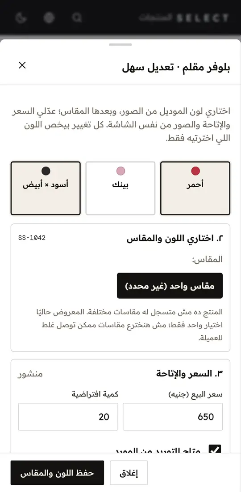
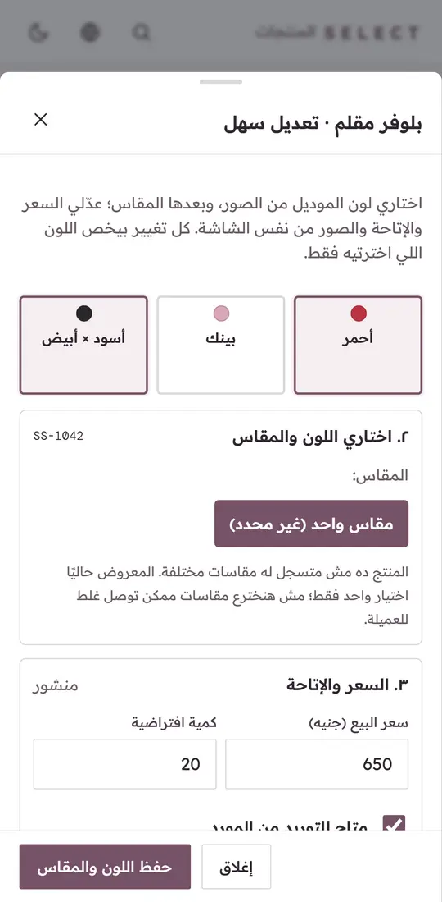
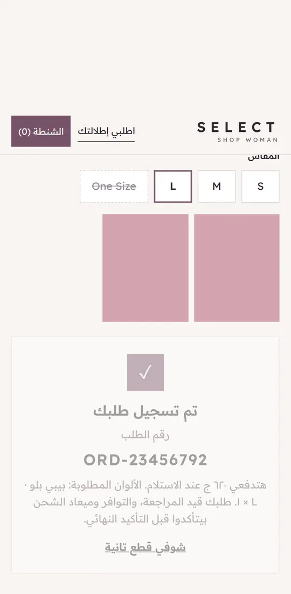
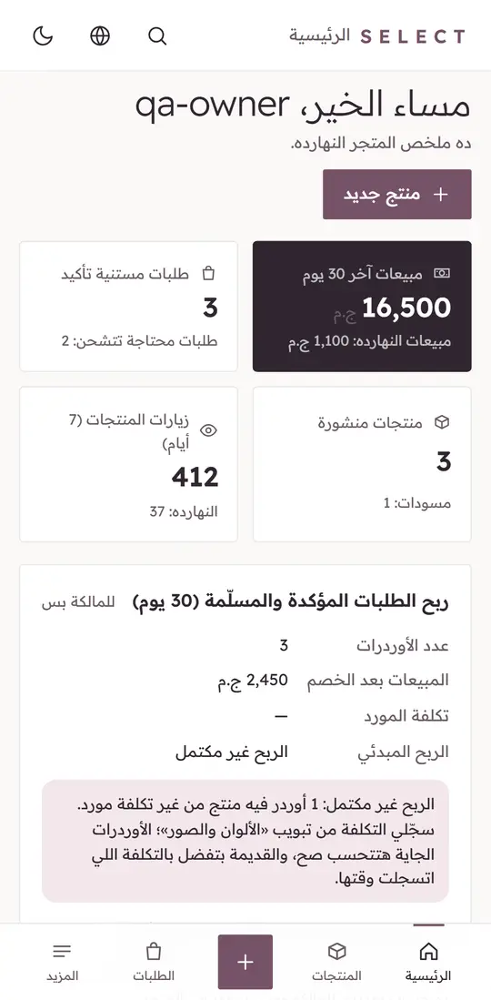

# SELECT SHOP WOMEN — one model, real colours, supplier cost (2026-11-05)

Branch `feature/women-soft-luxury-models-20261105`, cut from `origin/release` (328bc7e, PR #46).
Nothing was merged, deployed or written to any database. Tests and screenshots used the local mock only
(`tooling/serve.mjs`): no GA4 hits, views or orders reached production. **Local success is not production proof.**
Figma: https://www.figma.com/design/wGzZe8pBrl0mgk0czTaz8p (page "Soft Luxury · 2026-11-05").

## What was done
| Area | Result |
|---|---|
| Admin: add a model in 3 steps | ١ البيانات (name, category, description, price, supplier cost, main photo, saved as draft) → ٢ الألوان والصور (+ إضافة لون: palette name, own photos, own sizes incl. One Size, optional price, "متاح عند المورد"; real Options/Variants) → ٣ المعاينة والنشر (customer preview, review list, "حفظ مسودة" reads back from the server, then publish). Egyptian-Arabic errors; partial failures say what was saved. |
| Photos | Several photos per colour, uploaded per photo with progress; cover/"غلاف اللون" ordering; existing optimizer (WebP, 1600px); nothing old is ever deleted. |
| Legacy products | SS-1011 and old per-colour SKUs open and edit as before; codes, links and orders unchanged. No automatic merge or delete (a one-SKU product shows a note instead of a colour option). |
| Landing pages | Choosing a colour shows its photos, only its real sizes and its price; the order carries the exact Variant (code, colour, size). Palette swatches load lazily. SS-1011 stays an ordinary catalog card; no jacket in the hero. |
| Soft Luxury palette | Ivory #F8F5F2, Mauve #765268, Dusty Rose #D4A4AF, Champagne #C3A582, Plum Ink #302630 on store, LP, cart, checkout and Admin. |
| Supplier cost and profit (Owner only) | Cost per model or per size; live "ربح مبدئي 200 ج.م (٣٦٫٤%)" for 550/350; below-cost warning without touching the price; cost saves never change the price. Dashboard: profit of confirmed/delivered orders (30 days), "الربح غير مكتمل" when a cost is unknown, net estimate with store-paid shipping, ad cost/order and other fees (customer-paid shipping is not profit). Staff never see or load costs. |
| Fix found while testing | Admin router: a slow earlier screen could draw over the current one on first load. Now an overtaken navigation stops before drawing. |

## Tests (local, Windows)
| Check | Result |
|---|---|
| Unit `node --test` (tooling) | 121/121 (incl. profit maths 550/350 → 200 / 36.4%, discounts, returns, unknown cost) |
| Image optimizer tests | 12/12 |
| Typecheck + lint (LP runtime, tooling, Admin) | clean |
| Playwright mobile + desktop, full suite | 160 passed · 0 failed · 14 skipped |
| New e2e: 3-colour model (save → reopen → preview → publish), staff permissions, SS-1011, cost ops missing, dashboard profit, LP colour/size/price → mock COD order | pass; colour-model suite ×6 = 72/72 |
| DB dry run (throwaway Postgres 17, production migration order, synthetic data) | cost rules 27/27 on today's schema and 27/27 after the stock migration; stock rules 42/42 unchanged |
| Upload 2 / 10 / 20 MB (mobile + desktop, real browser) | all uploaded → WebP 1600px, 208 / 172 / 97 KB, 1.4–3.4 s |

Lighthouse (mock, median of 3, mobile): before → after

| Page | Perf | LCP |
|---|---|---|
| `/lp/ss-1008/` | 100 → 100 | 1.10 → 1.25 s |
| `/lp/?p=SS-1008` | 100 → 99 | 1.51 → 1.95 s (still ≤ 2.0 s; the colour picker work) |
| `/` | 98 → 98 | 1.85 → 1.84 s |

GA4 `G-NB8PZCX35Z` and the Meta Pixel are untouched (`git diff origin/release -G "G-NB8PZCX35Z|fbq("` is empty; the ID lives in `js/analytics.js` as before). URLs, product codes and the order flow are unchanged (existing e2e for tracking, redirects and COD all pass).

## Screenshots
| Before (live `release`) | After |
|---|---|
|  |  |
|  |  |

Colour model in Admin (step 3 preview) · LP order after choosing a colour and size · Owner profit card:

  

## Needs approval (backend, not done here on purpose)
1. **B1 — LP colour photos in production:** deploy women-checkout with `media[].target` (backend commit `0a2e668`, branch `feature/product-discovery-20261022`). Until then the LP keeps showing the model's shared photos; per-colour sizes and prices already work.
2. **B3 — supplier cost:** apply `supabase/migrations/20261105100000_women_supplier_costs.sql` (backend branch `feature/women-supplier-cost-20261105`, commit `1989d07`; dry run: `node ci/women-supplier-cost/run.mjs <deps>`). Additive only: two new tables, a snapshot trigger that can never block an order, Owner-only ops in front of the deployed `women_admin_call`; rollback block included. Until applied, the Admin shows "محتاج تفعيل من السيرفر" and nothing breaks.
3. *(optional)* B2 — colour-level photo upload in women-admin (`6e96015`). Not needed: photos are already tagged per colour through its Variant.

Known limits: orders placed before B3 have no frozen cost and show as "غير مكتمل" (no back-fill with today's cost); returns count per whole order, not per item.

## Launch steps
1. Review and merge this PR into `release` (GitHub Pages publishes it).
2. Approve and apply B3 in the WOMEN Supabase project only (never the CLEAN or orders projects); run `costs.get` for one product as the Owner.
3. Approve and deploy B1; open one multi-colour LP and switch colours on a phone.
4. Enter supplier costs for live models from «الألوان والصور»; watch the dashboard profit card turn from "غير مكتمل" to complete as new orders arrive.
