# SELECT SHOP WOMEN — premium pass (2026-11-04)

Branch `feature/women-premium-polish-20261104`, cut from `origin/release` (live code, includes merged PR #41–#44).
Nothing was deployed, merged, or written to any database. All tests and screenshots ran against the local mock
(`tooling/serve.mjs`), so no GA4 hits, product-view counts, or orders reached production.

## What changed

### Landing pages (all 46 pages + the automatic `/lp/?p=` page, regenerated from `tooling/build-lp.mjs`)
| Problem on live (mobile) | Fix |
|---|---|
| Header broken: «اطلبي إطلالتك» overlapped the logo, the bag counter wrapped as `(0` / `)` | One-line header: logo · jump link · bag, nothing wraps |
| Photo cropped to a 330px strip under a slogan | Product photo first, full width, 4:5 (same image file, so LCP unchanged) |
| «تأكيد الطلب» wrapped to two lines in the sticky bar | Both buttons share the bar and stay on one line |
| Colour picker inside the order form sat at the very bottom (mobile) / above the heading (desktop) | Under «اطلبي دلوقتي», before quantity and fields |
| Photo zoom only on SS-1011 | Every product page: tap a photo → full-size original (loaded only when opened) |
| No reassurance near the price | Trust strip: الدفع عند الاستلام · شحن لكل المحافظات · الإجمالي واضح قبل التأكيد (same promises already in the notes list) |
| Raw description lines («اللون:بني / ONE SIZE») floating at the end | Titled «تفاصيل القطعة» |

Unchanged on purpose: runtime/order logic, both colour pickers (tested behaviour from earlier PRs), cart button,
COD-only flow, A/B snippet, prefetch, GA4/Meta tags, URLs and redirects.

### Admin (products list)
The on-demand note and status counts were two large cards; on a phone, staff scrolled ~1700px before reaching search
and products. Now one compact card: one-line on-demand reminder (full text expands), 4 status tiles in one row.
Search and the first product are on the first screen. Text, links and counts are the same.

## Test results (local, Windows)
| Suite | Before (release) | After |
|---|---|---|
| Unit (`node --test`) | 101/102 (1 = CRLF checkout artifact) | 103/103 (+1 new test) |
| E2E Playwright, mobile + desktop | 142 passed · 14 skipped · 2 failed | 142 passed · 14 skipped · 2 failed |

The 2 e2e failures are the same in both runs: `sweater-campaign.spec.mjs:34` builds a file path with
`new URL().pathname`, which becomes `D:\D:\…` on Windows. Test bug, not a site bug; passes on Linux CI.

Cold ad-link loads (Facebook/Instagram in-app, slow 4G), hero LCP:

| Page | Before | After |
|---|---|---|
| /lp/ballon-suit/ | 1480 ms | 1228 ms |
| /lp/ss-1008/ | 1208 ms | 1272 ms |
| /lp/?p=SS-1099 | 1864 ms (CLS 0.043) | 1576 ms (CLS 0) |

Interaction (INP proxy, Event Timing on the size tap, `lp.spec.mjs`): 24–32 ms before and 24–32 ms after (target ≤ 200 ms).
CLS on every measured cold load: ≤ 0.014 after (target ≤ 0.1).

Lighthouse lab scores: Lighthouse could not launch Chrome on this Windows machine (`spawn UNKNOWN`), so it was not run
locally. The PR's CI (`women-lp-ci.yml`, `women-storefront-perf.yml`) runs Lighthouse on Linux against the same mock
and reports it on the PR.

## Round 2 (after review of round 1)

### 1. Slow 3G LCP on landing pages
Cause (from the waterfall, `tooling/waterfall.mjs`): while the hero photo downloads, the brand fonts and the gallery
thumbnails share the same slow connection, so the photo arrives late.
Fix in `build-lp.mjs`: the gallery thumbnails and the brand fonts wait until the hero photo has loaded (`html.hl`,
set by the hero's own `onload`/`onerror`, so nothing waits forever). Before the hero loads, text shows in the system
font; the brand font swaps in right after. The same photo file stays the hero, so no product data or image changed.

Measured on the Pixel 7 profile, median of 3 cold loads, "before" = `origin/release` on the same mock:

| Page | Slow 3G before | Slow 3G after | Slow 4G (Lighthouse mobile) before | after |
|---|---|---|---|---|
| /lp/ballon-suit/ | 5268 ms | **2612 ms** | 1536 ms | **868 ms** |
| /lp/ss-1008/ | 3392 ms | **1732 ms** | — | — |
| / (home) | 4688 ms · CLS 0.247 | 4588 ms · CLS **0.048** | 1788 ms | 1896 ms (same within noise) |

CLS ≤ 0.005 on every LP. On Slow 3G, home is still above 2.5 s: its first card cannot render before
`app.js` has run and the catalog API has answered (chain HTML → scripts → `/catalog` → card), and that was the
same before. Ads open the landing pages, which now meet the target. Home at Lighthouse's own mobile profile is under 2.5 s.

### 2. Home page: shop-first direction (Figma)
Two mobile directions were drawn in Figma («SELECT SHOP WOMEN · Home direction 2026-11»):
A = large editorial cover photo + one featured piece; B = short heading, the promises up front, products on the first screen.
**B was chosen**: A needs the owner to pick a cover piece by hand (and it stays wrong if that piece is hidden), and a
large cover photo pushes the products and the first paint further down.

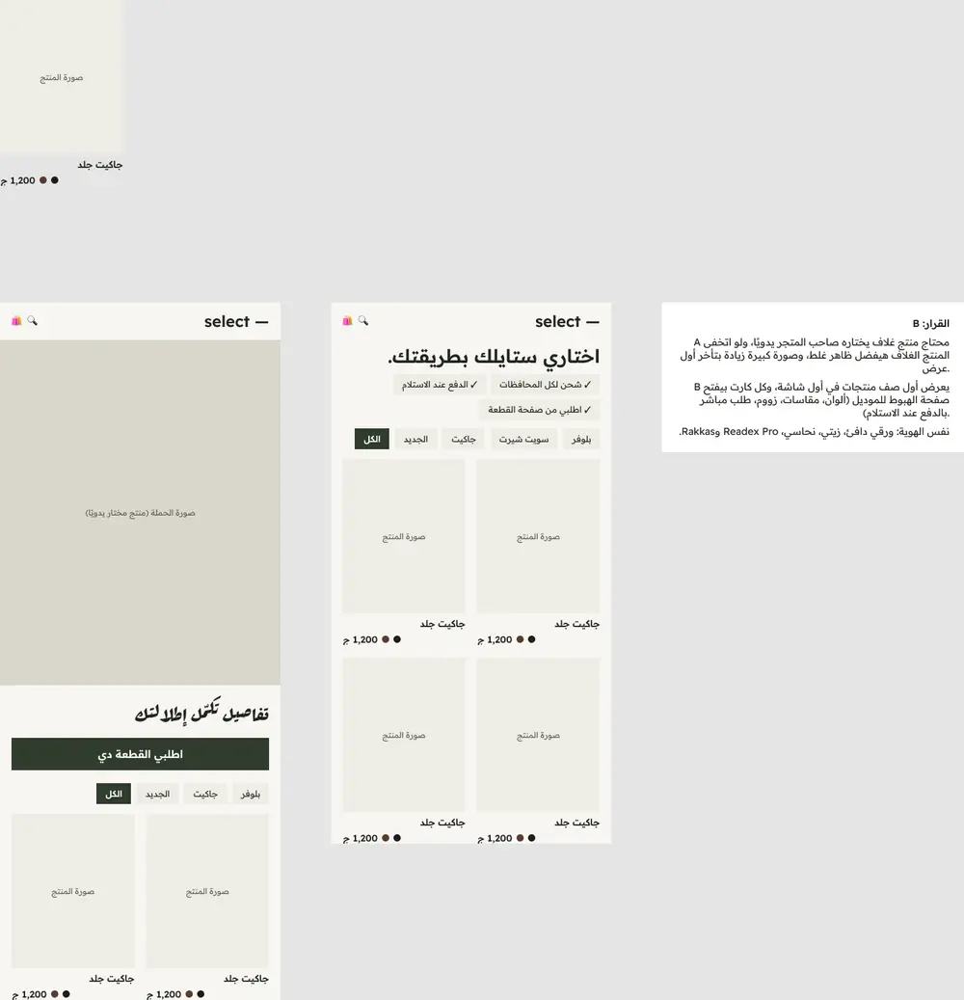

Implemented in `index.html` + `css/atelier-site.css` only (no new JS, no new image, ~1 KB CSS):
- Promises moved from the bottom into the hero as one row: الدفع عند الاستلام · شحن لكل المحافظات · اطلبي من صفحة القطعة مباشرة
  (static HTML, so no layout shift; scrolls sideways on narrow phones instead of wrapping).
- Phone: shorter heading (one line), owner description capped at 2 lines, compact «كل القطع» header.
- First product card: 433 px → **371 px** from the top on a Pixel 7, so the full first row (photo, name, price, colours) is on the first screen.
- Each card still opens its model landing page (Landing-Page-first): colours, size, zoom and the direct COD order live there.
- Owner-managed text (title, highlight, description, announcement) still comes from Admin unchanged.

| Before | After |
|---|---|
| 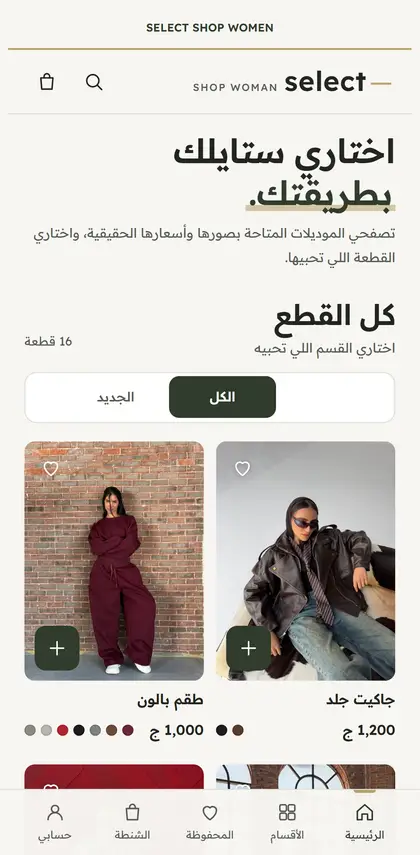 |  |

### 3. Real mobile order journey (local mock)
`tooling/journey-shots.mjs`: home → first card → model page → photo zoom → colour switch → form → confirmation.
Every non-local request is aborted; the script checks that exactly one order reached the mock (result: 1 order, 0 external requests).

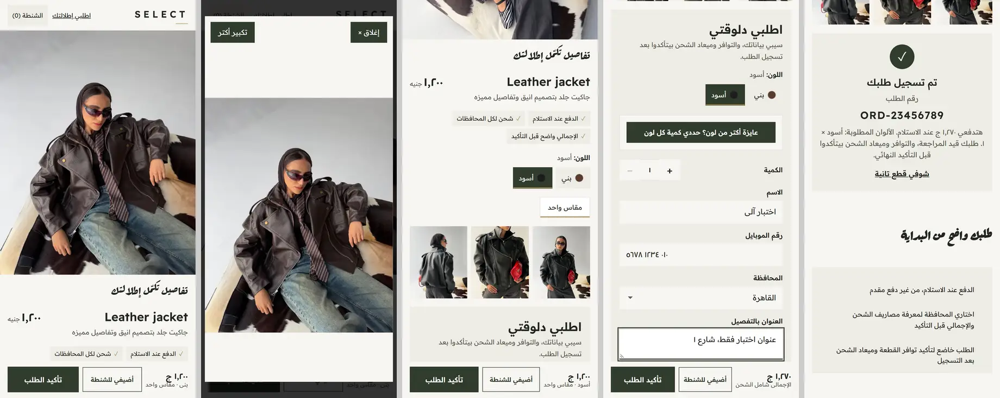

### 4. Windows Playwright error
`sweater-campaign.spec.mjs` now builds the file path with `fileURLToPath(...)` instead of `new URL().pathname`.

### Tests after round 2 (local, Windows)
| Suite | Result |
|---|---|
| Unit (`node --test`) | 103/103 |
| E2E Playwright, mobile + desktop | **144 passed · 14 skipped · 0 failed** (was 142 · 14 · 2) |

### CLEAN patterns
CLEAN is Next.js/React with its own database and roles; no component or backend was copied. Its UX ideas map to WOMEN like this:

| CLEAN pattern | WOMEN equivalent |
|---|---|
| One product detail sheet | Admin product sheet (#42) |
| Colour × size matrix (StructureEditor) | Simple colour-size editing (#43) |
| Photos per variant (MediaManager) | Photo upload per colour (#42) |
| Status controls + badges | Publish control and status overview (#44), compact status tiles (this PR) |
| Benefit chips near the top of the storefront | Home trust row + LP trust strip (this PR) |

## Not done / blockers
- **Home Slow 3G LCP** (4.6 s): needs the catalog request to start before `app.js` (e.g. an inline early fetch the app reuses). It is a small JS change in the order-critical storefront script, so it is left as a separate step.
- **Live GA4 numbers in Admin**: still via GA4 report import (#44). A live feed needs a backend GA4 Data API service account — a backend change, not in this PR.
- **Production field data** (real-user LCP/INP): needs the deployed site; measure after release.
- Backend draft PRs (#43–#54 in staging) were not touched; nothing here depends on them.

## Round 3: "Maison" redesign (visual identity, not spacing)

Review of round 2: the site still looked like the old one. Round 3 replaces the visual identity on all four surfaces
(home, product/landing pages, the automatic `/lp/?p=` page, Admin) while keeping every function, product, colour, size,
order path, GA4 (`G-NB8PZCX35Z`), Meta Pixel, and virtual stock untouched. No new library, font file, or script.

**Figma:** page «Redesign · Maison (2026-11)» in https://www.figma.com/design/wGzZe8pBrl0mgk0czTaz8p (node 4:44).
The mobile home, landing page, and Admin list were drawn there first. Chosen direction: a fashion-house look
(ink black, warm ivory, champagne gold accents, square edges, light large type), built on the brand font already
self-hosted (Readex Pro 300–600).

### What changed visually
| Surface | Before | After (Maison) |
|---|---|---|
| Home, first mobile screen | Heading + chips + 2 small cards | **Full-bleed product cover** with name, live price, «اطلبي الآن» (straight to the order form) and «تسوقي الكل»; promises in a 3-column strip below |
| Home, header | Olive wordmark, left-aligned | Centred letterspaced **SELECT / SHOP WOMAN** wordmark, ink announcement bar with a gold rule |
| Home, cards and sections | Rounded cards, green «+» | Square cards, ink «+», «THE EDIT» section kicker, ink full-bleed promise band and footer |
| Landing pages | Script heading «تفاصيل تكمّل إطلالتك», green buttons | **Floating ivory card over the photo** (gold rule, light 30px title, price, promises all on the first screen); ink sticky order bar with an ivory «تأكيد الطلب»; square colour chips with an ink pressed state; white order panel |
| Admin | Rounded olive UI | Ink top bar (phone) / **ink navigation column** with gold active mark (desktop), outlined square status badges, status counts as an editorial index (light large numerals in hairline columns) |

The home hero shows the first purchasable product from the live catalog (falls back to SS-1008, whose photo is in the HTML).
Its photo is preloaded in `index.html`, so the first paint no longer waits for the catalog API.

### Before / After (real Chromium, Pixel 7 and 1366×900, local mock)
| | |
|---|---|
| Home (mobile) | 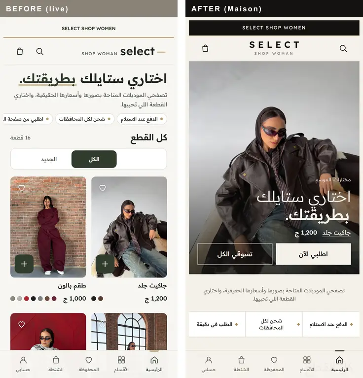 |
| Landing page (mobile) | 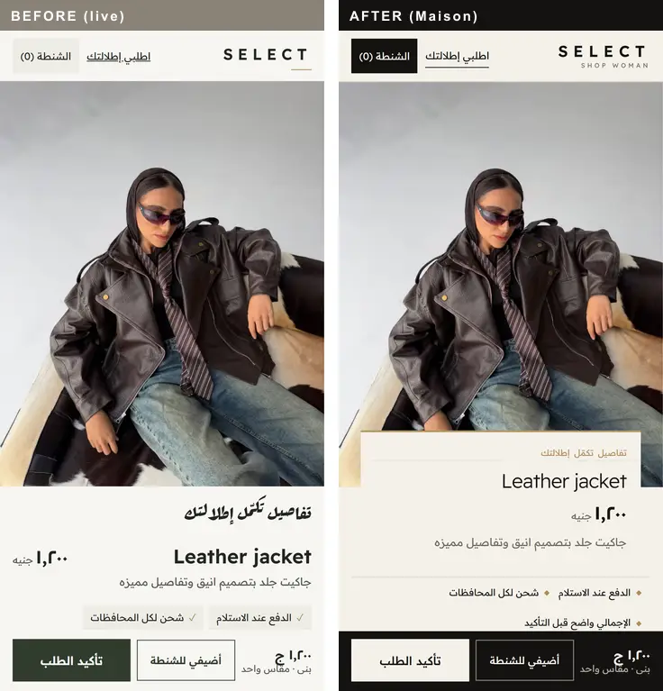 |
| Home (desktop) | 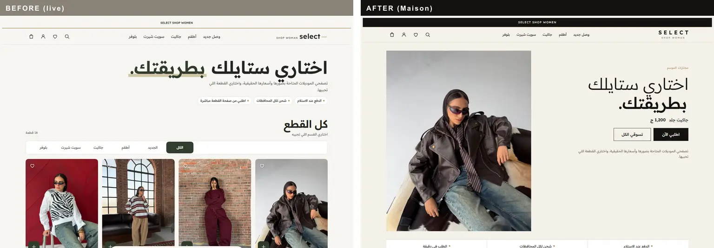 |
| Landing page (desktop) | 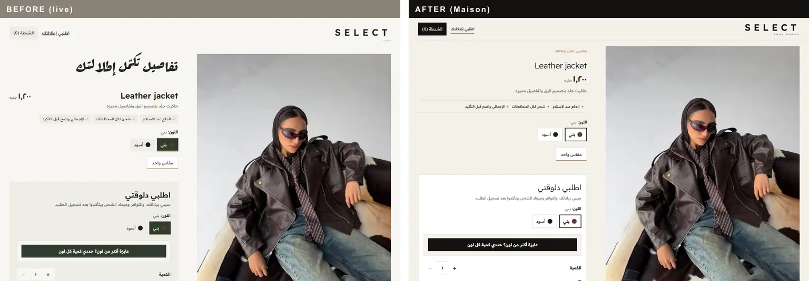 |
| Admin products (mobile) | 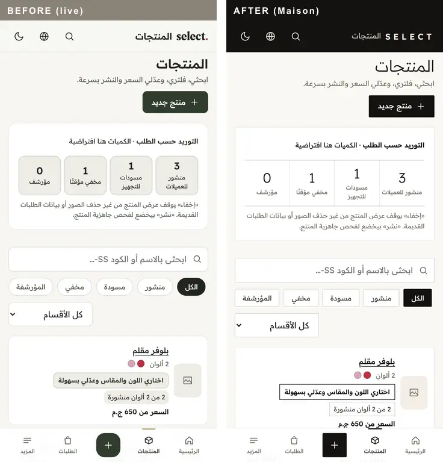 |
| Admin products (desktop) | 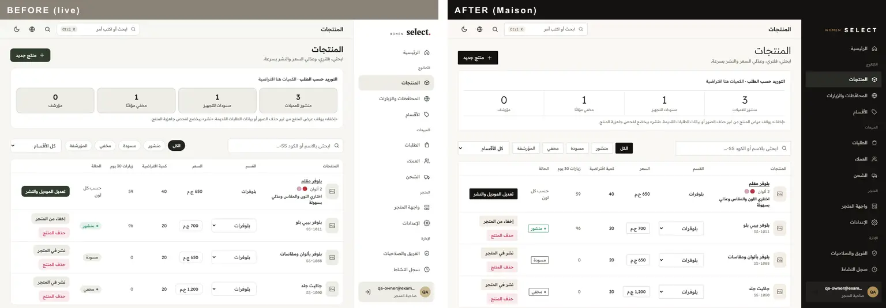 |
| Admin product edit (mobile) | 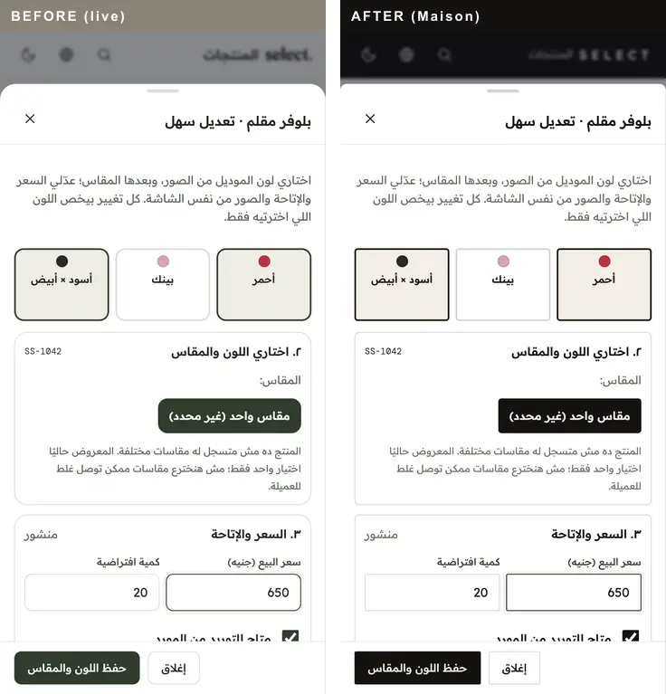 |
| Admin dashboard (desktop) | 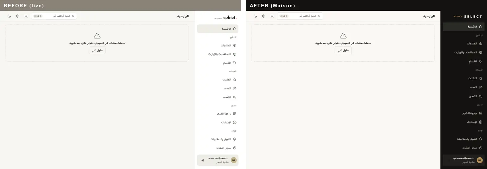 |

Mobile order journey on the new design (home cover → model page → zoom → colour → form → confirmation; 1 mock order, 0 external requests):

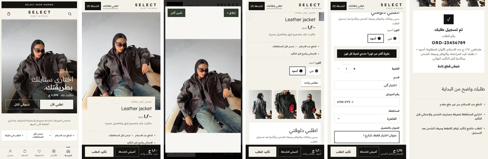

### Preview before publishing
Nothing is deployed. To see it locally (mock data, no production writes, no GA4):
```
cd tooling && PORT=4180 node serve.mjs
```
then open http://127.0.0.1:4180/ (use `127.0.0.1`, not `localhost`: the mock API allows that origin only).
`/lp/ss-1008/`, `/lp/ballon-suit/` and `/admin/` (Admin needs the `admin-shots.mjs` harness, since login is real).

### Speed (Pixel 7 profile, cold load, median of 3, same mock; before = `origin/release`)
| Page | Slow 3G before | Slow 3G after | Slow 4G before | Slow 4G after |
|---|---|---|---|---|
| / (home) | 4628 ms · CLS 0.247 | **2332 ms** · CLS 0.071 | 1908 ms | **1584 ms** |
| /lp/ballon-suit/ | 5260 ms | **2828 ms** | 1636 ms | **904 ms** |
| /lp/ss-1008/ | 3232 ms | **1500 ms** | 972 ms | **732 ms** |

The home page now meets the 2.5 s target on Slow 3G too (round 2's open blocker): the first paint is the preloaded
cover photo instead of a card that waited for `app.js` + the catalog API. The redesign adds no font file, script, or library.

### Tests after round 3 (local, Windows)
| Suite | Result |
|---|---|
| Lint | clean |
| Unit (`node --test`) | 103/103 |
| E2E Playwright, mobile + desktop (orders, colours, sizes, stock, events, cart, Admin styles) | **144 passed · 14 skipped · 0 failed** |
| Mobile order journey (`journey-shots.mjs`) | 1 mock order, 0 external requests |

Test updates were only to pinned visual values (new tokens `#141310`/`#f5f1ea`, CSS cache-bust `v=20261104-1`).
Still not done: production field data (needs the release), and review/approval of this design before any merge or deploy.

### Final screenshots (round 3, local mock)
Storefront, mobile: home cover · catalogue · leather jacket page · Balloon Suit page · its colour chooser and order form

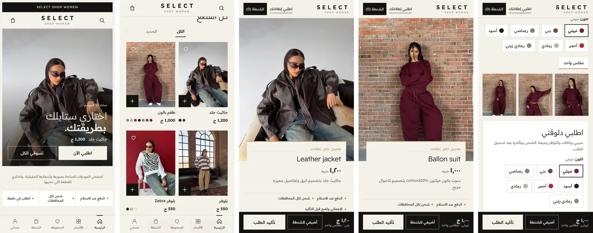

Storefront, desktop: catalogue (THE EDIT) · Balloon Suit page

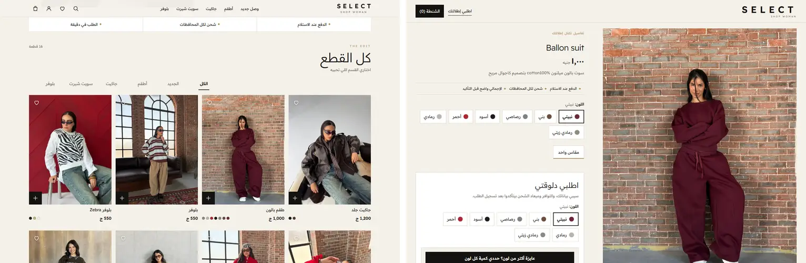

Admin, mobile: products · colour/size/price/virtual stock sheet · product editor (data, photos, sizes, publish) · orders · order detail (confirm/cancel)

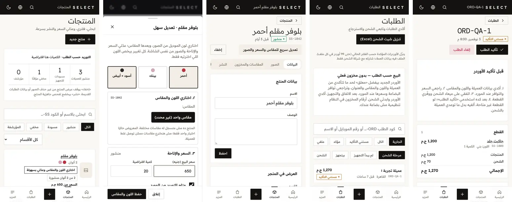

Admin, desktop: orders · order detail

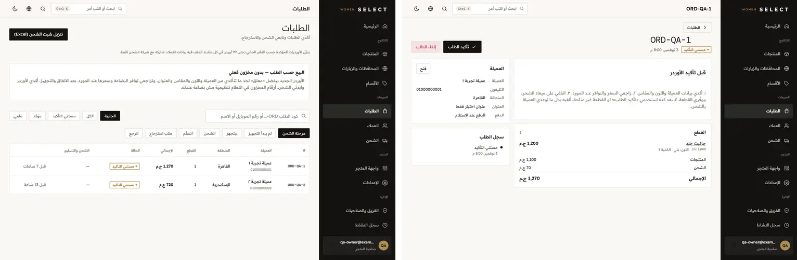

Admin flows tested by Playwright (mock API, no Supabase): create product with field errors → photo step; edit grouped colour and virtual
quantity; photo upload attaches to the exact colour only; hide a published product, incomplete product cannot republish;
catalogue-only staff cannot change price/stock. Orders list/detail rendered with fictional QA orders (`admin-shots.mjs`).
